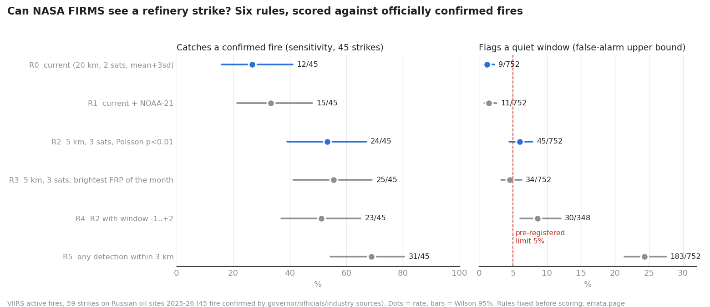

# Result (2026-10-19 03:20 UTC): what "no clear fire" means

Scored by `evaluate.py` exactly as pre-registered in RULES.md (the only later edits to the public copies are file
paths and the key's location). Ground truth: 59 strikes on Russian oil sites 2025-26, 45 with a fire confirmed by
a governor (41 of all cases), other officials (15) or industry sources to Reuters (3); none of the confirming
sources cites satellite data, so no case is circular. 14 cases where officials said the attack was repelled
without fire are descriptive only.

| rule | catches confirmed fire | flags "no fire" cases | flags quiet windows | LR+ | LR- |
|---|---|---|---|---|---|
| R0 current collector | 12/45 (27%, 16-41) | 1/14 | 9/752 (1.2%) | 22 | 0.74 |
| R1 R0 + NOAA-21 | 15/45 (33%) | 1/14 | 11/752 (1.5%) | 23 | 0.68 |
| R2 5 km, Poisson | 24/45 (53%, 39-67) | 6/14 | 45/752 (6.0%) | 9 | 0.50 |
| R3 5 km, brightest FRP | 25/45 (56%) | 4/14 | 34/752 (4.5%) | 12 | 0.47 |
| R4 R2, window -1..+2 | 23/45 (51%) | 3/14 | 30/348 (8.6%) | 6 | 0.54 |
| R5 any detection 3 km | 31/45 (69%) | 7/14 | 183/752 (24%) | 3 | 0.41 |

**Primary comparison, by the rule fixed in advance:** R2 beats R0 by 27 points of sensitivity, but flags 6.0% of
quiet windows, above the 5% limit. So the collector does **not** switch to R2.

**What "no clear fire" meant:** almost nothing. The current rule misses about three of every four fires that the
local governor himself confirmed. A flag is strong evidence (likelihood ratio ~22), its absence is weak evidence
(likelihood ratio 0.74: odds of a fire drop by a quarter). Even the most permissive rule, any detection within 3
km, misses 14 of 45 confirmed fires: small or quickly extinguished fires, clouds, and the gap between overpasses.

**Changes made:** the collector now uses all three VIIRS satellites (R1, strictly more data, quiet rate 1.5%) and
prints "not seen (uninformative)" instead of "no clear fire". R3 looked best on the descriptive rules (56% at
4.5%), but choosing it now would be choosing on this data; it is a candidate for a prospective test on new strikes,
not an adopted rule.

**Limits:** quiet windows may hold unlisted strikes, so their rate is an upper bound on false alarms. The "no fire"
negatives rest on official statements; R2 flagging 6 of 14 of them is either false alarms or fires that were not
admitted, and this data cannot say which. 27 of 45 positives have unknown fire size.
